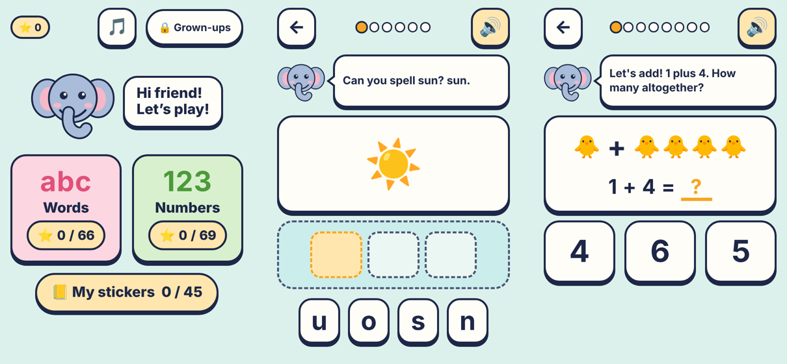

# Little Learner Trail

A level-based learning game for children aged 4 to 7. Kids practise **phonics, spelling, phrases and sentences** in the Words track, and **counting, adding and taking away** in the Numbers track. Every level ends with 1 to 3 stars and a sticker. A friendly baby elephant called Gajju talks them through it.

The whole game is a single `index.html` file: no install, no account, no ads. Your child's progress and answers never leave the device.



## Play

- **Online:** open the GitHub Pages link in the About section of this repository.
- **Offline:** download `index.html` and open it in Safari, Chrome or Edge.

Progress is saved in that browser on that device.

## What's inside

| Track | World | Skills |
|---|---|---|
| Words | Sound Garden | Letter sounds in Jolly Phonics order (s a t i p n …), first sounds, sh ch th ck ng, ai ee oa oo ar or |
| Words | Word Workshop | Building words letter by letter, middle sounds, tricky words |
| Words | Story Train | Phrases, polite words ("May I come in?"), putting sentences in order |
| Numbers | Counting Cove | Counting to 10, finding numbers, more or fewer, before and after, 11 to 20 |
| Numbers | Plus Park | Adding and taking away within 10, make 10, missing numbers, story sums |
| Numbers | Number Peak | Doubles, counting in 2s, 5s and 10s, tens and ones, > < = |

There are 45 levels. Each world ends with a boss level that mixes everything in it.

## How it encourages learning

- **Stars come from first-try answers:** 80% or more gives ★★★, 50% or more gives ★★, and finishing always gives ★.
- **Unlocking:** finishing a level opens the next one. Getting 2 stars on a boss opens the next world.
- **No timers, lives or red crosses.** After two misses the right answer gently pulses, and missed questions come back at the end.
- **Every prompt is spoken,** with a speech bubble showing the words. Letter sounds are spoken as sounds ("sss, as in sun"), not letter names.
- **Rewards:** stickers, confetti, streak cheers, and Gajju earns a flower, cap, scarf and crown as stars add up.

## Privacy

- Progress, stars, the child's name and the PIN are stored only in the browser on the device. Nothing about the child is sent anywhere.
- The GitHub Pages site counts visits with [GoatCounter](https://www.goatcounter.com), which uses no cookies and collects no personal data. It records only that the page was opened, with browser type, screen size and country. The downloaded `index.html` counts nothing.

## For grown-ups

On the home screen, **press and hold "🔒 Grown-ups" for 3 seconds**, then enter your 4-digit PIN. The first time, a short setup screen walks you through it.

The Grown-ups area has:

- progress and first-try accuracy for each world;
- a daily time limit;
- music, sound effects and voice settings, with a sound check;
- an option to open all levels;
- change PIN and reset progress.

A web page can't lock a device. To keep a child inside the game, use **Guided Access** on iPad or iPhone, **App pinning** on Android, or **Screen Time** on a Mac.

## Development

There's no build step. Edit `index.html` and reload.

The game logic sits between `/*CORE-START*/` and `/*CORE-END*/` and can be tested without a browser:

```sh
node tests/core.test.js
```

The test generates every level's questions across hundreds of random seeds. It checks that each question has exactly one correct answer, no duplicate options and correct arithmetic. It also checks the star, unlock and PIN logic.

## License

[MIT](LICENSE)
